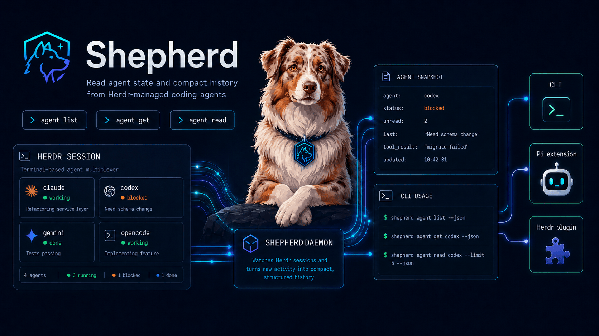

# Herdsman

Herdsman is a daemon-backed observability layer for coding agents running in Herdr. It provides two interfaces over the same durable agent index: pull-based CLI access to structured history, and owner-scoped Pi notifications with cached context and automatic wake.

Herdr's `herdr agent read` reads terminal streams or scrollback. Herdsman instead reads agent session data so callers can retrieve work status, structured message excerpts, compact tool results, and unread outcomes without parsing terminal output. Herdsman is read-only; use the official Herdr CLI or skill for agent start, prompts, waits, pane operations, and terminal control.

Herdsman resolves each pane's session history from the session identifier Herdr reports for that pane, never by scanning agent directories. It supports exactly two agents, both through values Herdr itself reports. Pi panes normally get a session path straight from Herdr, and Herdsman reads that file; when the pi integration cannot read its own session file path it sends an id instead, which Herdsman does not resolve — a pi session file name cannot be derived from its id alone — so such a pane reports no history. Antigravity CLI (`agy`) panes report a conversation id, and because that id names the conversation's own database file, Herdsman resolves it to `<home>/.gemini/antigravity-cli/conversations/<id>.db`, and only for a single exact match. Every other agent reports no history, whether or not Herdr has an integration for it (`herdr integration install <agent>`): Herdsman deliberately does not resolve any other agent's session identifier and never reads any other agent's session store. When the official value cannot be resolved — the agent has no installed integration, an id has no derivation Herdsman can verify, or the file is missing or fails Herdsman's file-safety checks — Herdsman logs one warning and reports the pane without history rather than guessing.

## Development conventions

Detailed development and contribution guidelines are maintained across:

- [AGENTS.md](./AGENTS.md): agent instructions, operational rules, and verification commands.
- [docs/plans/](./docs/plans/): active architecture plans, progress tracking, and design specifications.
- `.agents/notes/` is an optional, host-local scratchpad for architectural decisions and workarounds. It is untracked and not distributed with the public repository, so clones do not carry it.

## Requirements

The repository is Go-only (`go/` module, `go1.26.4` toolchain via `go/go.mod`):

- Go >= 1.26
- Herdr >= 0.7.0
- Pi >= 0.80.6 when using the Go `herdsman-pi` extension from the `pi-extensions` repository

## Install

This host runs the Go binaries under `/root/.local/lib/herdsman-go/` (with `/root/.local/bin/herdsman` exec'ing the Go CLI). Install from source:

```bash
git clone https://github.com/dorokuma/herdsman.git
cd herdsman/go
go build -o /tmp/herdsman ./cmd/herdsman
go build -o /tmp/herdsman-daemon ./cmd/herdsman-daemon
sudo install -m 0755 /tmp/herdsman /tmp/herdsman-daemon /root/.local/lib/herdsman-go/
```

## Start the daemon

Herdsman agent commands and Pi notifications require the daemon. The daemon watches all running Herdr sessions reported by `herdr session list --json`, rescans them every 60 seconds, and does not index stopped Herdr sessions. Runtime files live in `~/.herdsman` by default. Set `HERDSMAN_HOME` to use another directory.

On this host the production daemon is the Go binary `/root/.local/lib/herdsman-go/herdsman-daemon`, started directly by the systemd unit `herdsman.service`, which keeps it running: use `systemctl restart herdsman.service` to restart it.

For development or verification, run the daemon entrypoint in the foreground with an explicit temporary data directory, so the production data directory is not used as scratch space:

```bash
HERDSMAN_HOME=/tmp/herdsman-dev /root/.local/lib/herdsman-go/herdsman-daemon
```

## Main commands

- `herdsman agent list`: returns the daemon's latest cached status and last user / assistant excerpts for the selected workspace. Check each row's `updatedAt` when freshness matters.
- `herdsman agent get <target>`: performs an explicit detail lookup and returns one agent's metadata, compact history, and latest compact tool result.
- `herdsman agent read <target> --limit N`: performs an explicit history read and returns the latest N user / assistant / compact `tool_result` messages.

Each agent record keeps Herdr's optional live `name`, such as `reviewer`, separate from its runtime `agent` kind, such as `codex`. Human list output uses distinct `name` and `agent` columns, and JSON returns both fields. Inside a Herdr workspace, Herdsman selects the current workspace automatically.

```bash
herdsman agent list --json
herdsman agent get reviewer --json
herdsman agent read reviewer --limit 20 --json
```

From outside Herdr, pass a scope.

```bash
herdsman agent list --all --json
herdsman agent list --workspace wB --json
herdsman agent get reviewer --workspace wB --json
herdsman agent read wB:p2 --workspace wB --limit 20 --json
```

`<target>` first matches an exact pane id, terminal id, or Herdsman agent id in the selected scope. It then matches an exact Herdr live name such as `reviewer`; when no live name matches, it falls back to a unique agent kind such as `codex`. Use `--session <name>` when a target is ambiguous across running Herdr sessions.

## Agent Skill

Install the Herdsman CLI and start its daemon before adding the Agent Skill. Then add the Herdsman instructions to supported coding agents:

```bash
npx skills add dorokuma/herdsman --skill herdsman -g
```

The Herdsman skill reads structured agent status, compact history, and recent tool results. Use it alone for agent inspection.

Add the official Herdr skill when an agent needs to control workspaces, tabs, panes, terminal input/output, or waits:

```bash
npx skills add ogulcancelik/herdr --skill herdr -g
```

## Pi extension

Install the Go `herdsman-pi` extension through Pi from the `pi-extensions` repository:

```bash
pi install github:dorokuma/pi-extensions/go/herdsman-pi
```

The extension requires Pi 0.80.6 or newer and connects to the Herdsman daemon when Pi runs inside Herdr. Each connected Pi registers its exact Pi session path as presence identity, including while off. After a successful register it sends `agent.ping` at least every 30 seconds so the daemon heartbeat does not drop an idle connection. The extension sends no per-turn tool-result or message telemetry; after its own final assistant message is written to the session file it sends a turn-completion signal, so completed and blocked outcomes carry a non-empty final response.

Enter `/herdsman on` in Pi to make this terminal the sole Herdsman owner for its current Herdr session and workspace. Only the owner receives cached current-workspace agent context, pending counts, agent updates, and automatic wake. Its context excludes its own Pi terminal and includes other Pi terminals. A normal prompt injects the locally cached snapshot without daemon RPC or history reads, so context can be temporarily absent after startup, reconnect, or scope movement until a snapshot arrives.

Completed or blocked agent outcomes start one visible Herdsman turn. If a normal user run is active, Herdsman waits for it to settle. The themed card shows up to three agents; use Pi's expand key to see every outcome and its complete final response. Named agents appear as `reviewer · Codex`, with `Codex` as the unnamed fallback. Agent output is untrusted evidence: Pi may continue only the existing user request and must not expand its scope.

Use `/herdsman` or `/herdsman status` to inspect the current Pi, and `/herdsman off` to release owner behavior for that Pi. Turning one Pi off does not affect another owner. An off or non-owner Pi remains connected for a later claim, but receives no hidden agent context, pending counts, updates, or wake. The active Pi shows `◆ Herdsman`; pending outcomes add `· N agent updates` until a turn containing them produces a final assistant response, settles, and acknowledges every underlying event. A previously active Pi shows `◇ Herdsman · reconnecting` during transport recovery. With no owner, outcomes are not delivered, and outcomes created during the ownerless period are not replayed by a later claim. Reloads, reconnects, and direct replacement by another Pi preserve unacknowledged outcomes. Ownership follows the Herdr terminal across Pi session replacement and pane movement, and clears when that terminal remains disconnected beyond the grace period.

Upstream model errors are filtered out of the wake path: when the final assistant message (or a `failed` reason) is error-shaped text such as `API Error: 429`, `rate_limit_error`, `overloaded_error`, or a transport failure like `ECONNRESET` / `fetch failed`, the outcome is dropped silently. No wake turn starts, no context is injected, and nothing is notified; the event is still acknowledged so the daemon's delivery queue converges. Long substantive reports that merely mention status codes, retries, or timeouts are not affected. Filtering is on by default and adds no timeout or retry fallback while the upstream stays down. Configure it in `$HERDSMAN_HOME/config.yaml`:

```yaml
wake:
  filter_upstream_errors: true
  extra_upstream_error_patterns:
    - "your-provider-error-token"
    - /quota\s+exceeded/i
```

Set `filter_upstream_errors: false` to restore waking on every outcome. `HERDSMAN_WAKE_FILTER_UPSTREAM_ERRORS` and `HERDSMAN_WAKE_EXTRA_UPSTREAM_ERROR_PATTERNS` override the file, and config changes need a Pi restart.

## Herdr plugin

The `herdsman-herdr-plugin` (an optional Herdr UI integration) is not part of this Go-only repository; install it from the `pi-extensions` distribution channel if needed.

## Development

All commands run from the `go/` directory:

```bash
cd go
gofmt -l .          # must print nothing
go vet ./...
go test ./...
go build -o /tmp/herdsman ./cmd/herdsman
go build -o /tmp/herdsman-daemon ./cmd/herdsman-daemon
```

`make check` is the single check entry (gofmt, `go vet`, `go test -race`, both `go build` targets); CI and gates call it, and global git hooks scan commit messages and credentials at commit time. DB schema changes update `go/internal/db/schema.go` plus a new file under `go/internal/db/migrations/`; `sqlite_migrations_test.go` replays migrations against the schema to keep them in sync.

## License

[MIT](./LICENSE)
